<div align="right">
  <strong><a href="README.zh.md">简体中文</a></strong> | <strong><a href="README.md">English</a></strong>
</div>

# UNIHH-IOT 物联网数据采集与管理平台系统设计

[](https://github.com/unihh-iot/UNIHH)
[](https://adoptium.net/)
[](https://spring.io/projects/spring-boot)
[](https://www.mysql.com/)
[](https://redis.io/)
[](https://www.emqx.com/)
[](https://tdengine.com/)
[](https://github.com/unihh-iot/UNIHH/stargazers)
[](https://gitee.com/giteeRepo/unihh/stargazers)

## 1. 项目概述

UNIHH-IOT 是一套面向现代智能工业制造与物联网边缘协同场景的高性能、轻量化数据采集与设备资产管理平台。平台提供多协议南向数采接入、物模型动态建模、分布式规则计算、多存储引擎路由以及北向反向控制与通道生命周期管理能力。

### 1.1 核心特性

- **双向读写与全链路反向控制 (可读可写)**：全面支持高并发南向点位采集轮询 (Read / Decode)，以及北向控制指令毫秒级下发与寄存器/点位属性反写 (Write / Encode)。
- **分布式独立驱动架构**：驱动以独立微服务形式运行（如 Modbus、西门子 S7、OPC UA），彻底摆脱传统单体进程内 ClassLoader 动态加载与 SPI 机制带来的类隔离缺陷、内存泄漏与耦合风险，单驱动故障/重启完全不影响主平台与其它协议。
- **全生命周期 MQTT 总线托管**：底层驱动基于 `AbstractDriverPlugin` 与 `BaseDriverMqttManager` 实现开箱即用，自动完成在线注册、心跳保持、LWT 掉线遗嘱（Retained 保留消息）、配置热同步与反控指令监听。
- **通道级公平互斥锁**：针对工业现场 RS485 半双工总线与 TCP 单会话通信，驱动底层基于目标设备链路级公平锁（`getChannelLock`）实现读写串行化，彻底消除指令并发粘包与时序错帧。
- **统一物模型抽象**：支持属性 (Property)、服务 (Service)、事件 (Event) 三要素标准建模，支持物理点位与物模型测点的动态映射绑定。
- **多引擎策略存储支持**：存储模块 (`unihh-storage`) 采用策略模式与工厂路由设计，支持单条 (`save`) 与批量 (`saveBatch`) 数据持久化，无缝支持 TDengine、TimescaleDB、InfluxDB、ClickHouse、MySQL、Redis 及高频内存缓冲。
- **裸机/JAR包运维友好**：微服务间采用静态配置文件 (`application.yml` / 环境变量) 显式映射服务地址，支持单体 JAR 包直接 `java -jar` 快速启停与边缘部署。
- **极致低内存设计**：采用零拷贝、对象池复用、基本类型优先与 JVM 极小堆优化，单微服务进程堆内存可控制在 64MB ~ 128MB。

---

## 2. 系统界面预览 (System Screenshots)

### 2.1 监控大盘 / 系统总览
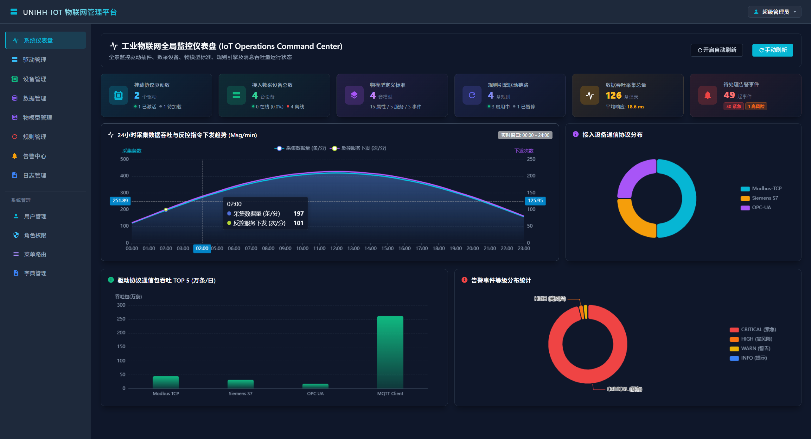

### 2.2 协议驱动管理与自检 (Protocol Drivers)
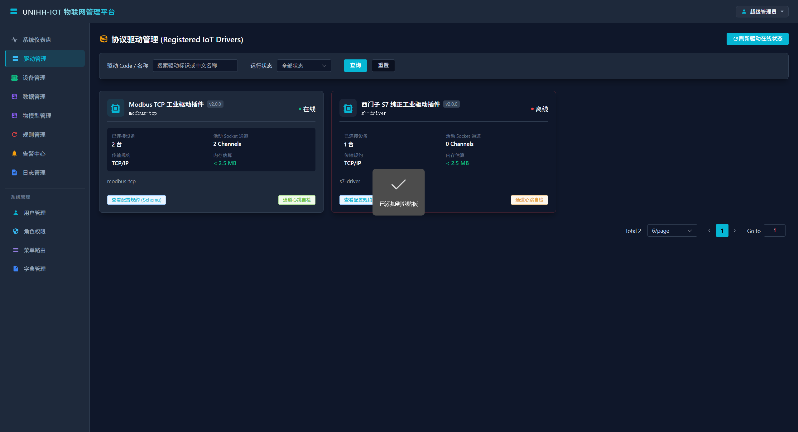

### 2.3 物理设备台账与连接管理 (Devices)
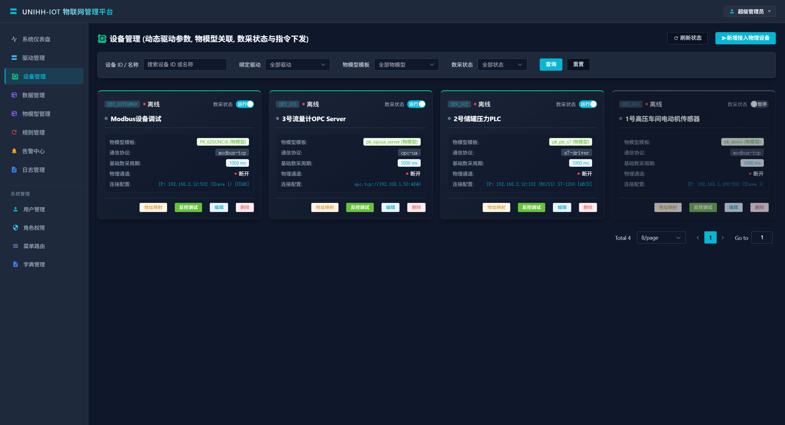

### 2.4 物模型参数与功能定义 (Thing Models)
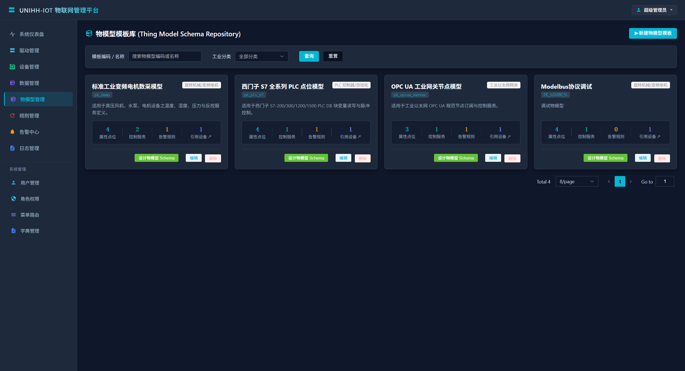

### 2.5 实时点位数据采集与监测 (Data Monitor)
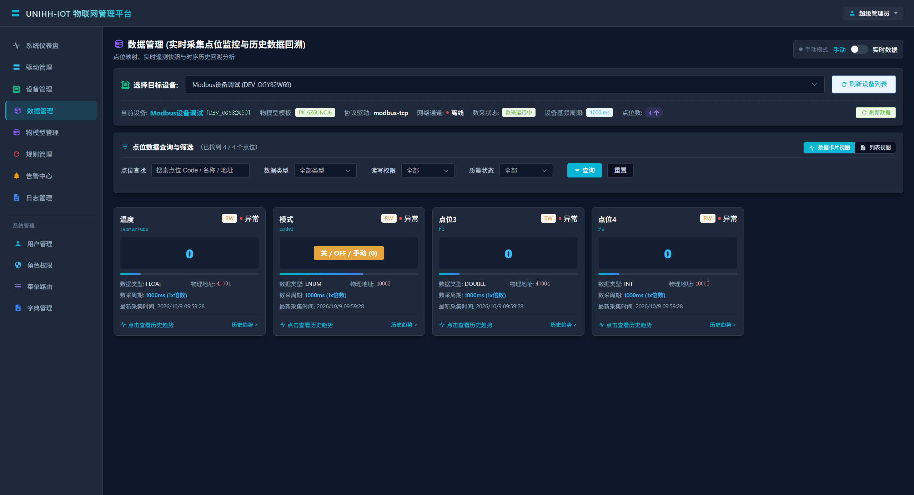

### 2.6 规则引擎与联动配置 (Rule Engine)
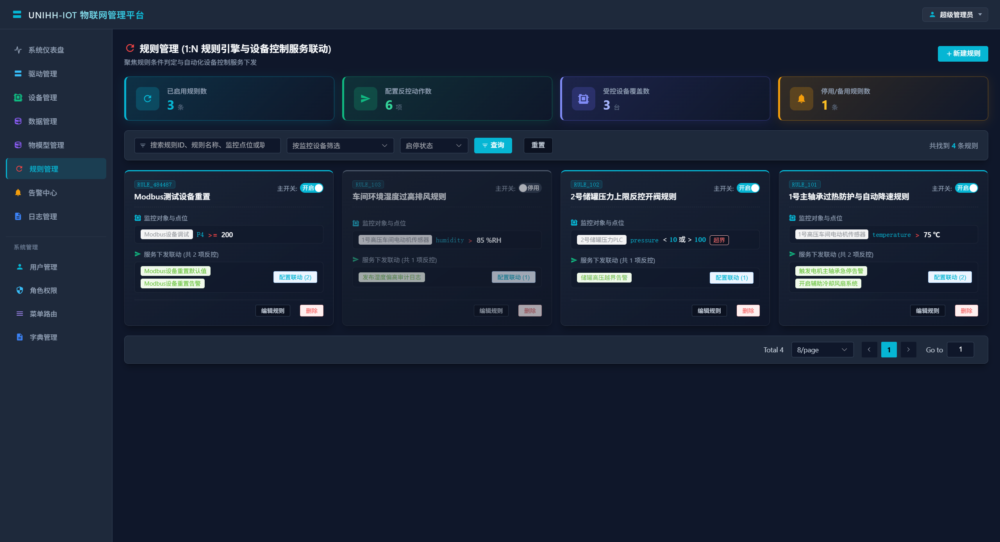

### 2.7 告警事件记录与处理 (Alarm Events)
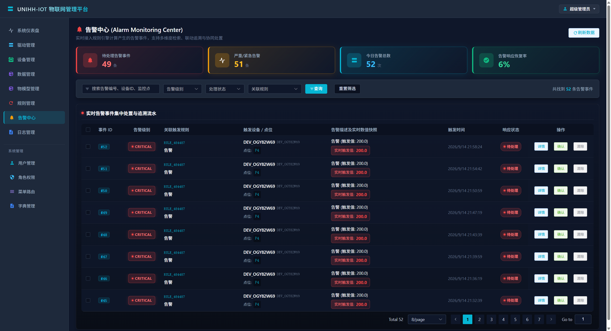

### 2.8 系统审计与操作日志 (Log Management)
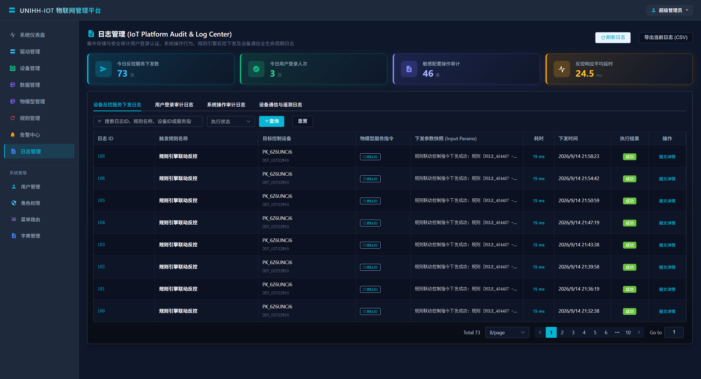

### 2.9 用户管理与权限体系 (User & RBAC)
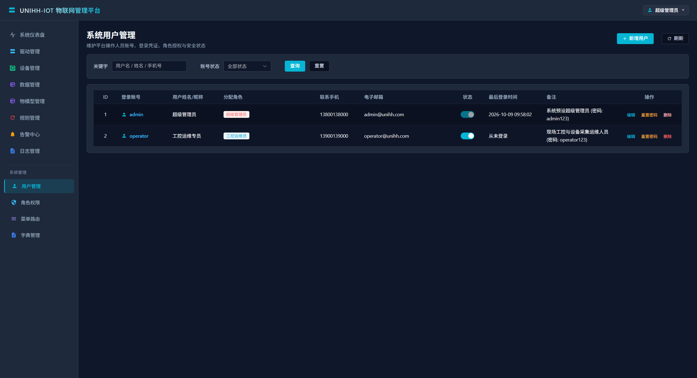

### 2.10 角色分配与功能权限 (Roles)
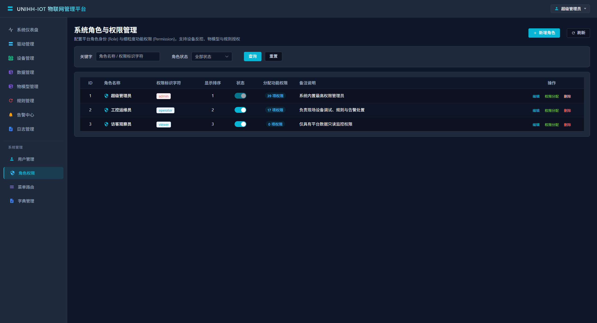

### 2.11 动态菜单路由管理 (Menus)
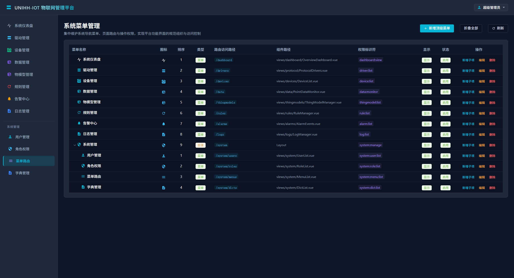

### 2.12 系统数据字典配置 (Dicts)
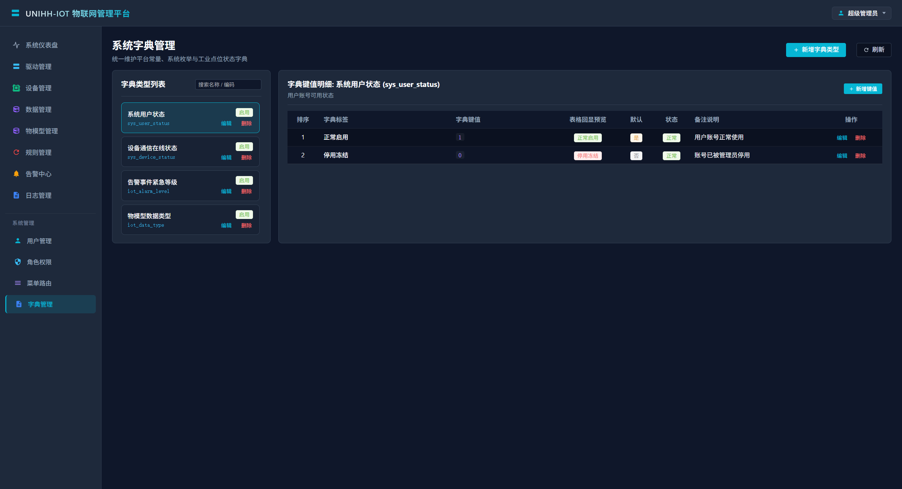

### 2.13 平台登录 (Login)
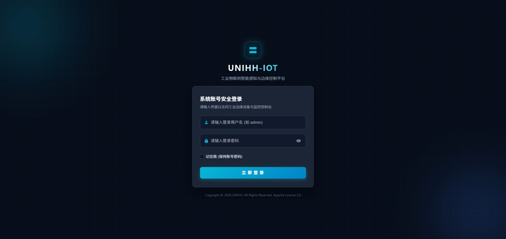

---

## 3. 快速启动与环境部署

### 3.1 拉取并启动 EMQX 工业消息总线环境镜像

平台官方提供了预置好工业 MQTT 消息总线配置与鉴权参数的专用 Docker 镜像，执行以下命令即可一键拉取并后台运行：

```bash
# 1. 从阿里云镜像仓库拉取 EMQX 环境镜像
docker pull registry.cn-shenzhen.aliyuncs.com/deversun/unihh-emqx:v20261009

# 2. 启动 EMQX 消息总线容器
docker run -d --name unihh-emqx \
  -p 1883:1883 \
  -p 8083:8083 \
  -p 8084:8084 \
  -p 8883:8883 \
  -p 18083:18083 \
  registry.cn-shenzhen.aliyuncs.com/deversun/unihh-emqx:v20261009
```

#### 端口映射说明
- `1883`：MQTT TCP 协议默认端口（后端微服务与协议驱动数据通信总线）
- `8883`：MQTT SSL/TLS 加密端口
- `8083`：MQTT WebSocket 通信端口
- `8084`：MQTT WSS (WebSocket with SSL) 通信端口
- `18083`：EMQX Dashboard 可视化管理控制台 Web 端口

### 3.2 默认服务账号与密码一览表

| 登录目标 | 访问地址 / 协议 | 用户名 | 密码 | 说明 |
| :--- | :--- | :--- | :--- | :--- |
| **EMQX Dashboard 控制台** | `http://localhost:18083` | `admin` | `public` | EMQX 官方管理面板，支持查看客户端连接、主题与吞吐 |
| **MQTT 客户端总线鉴权** | `tcp://localhost:1883` | `unihh` | `unihh` | 协议驱动与核心微服务连接 EMQX 总线的认证凭据 |
| **UNIHH-IOT 物联网平台** | 前端 Web 访问地址 | `admin` | `unihhiot` | 物联网平台超级管理员默认登录账号 |

---

## 4. 系统架构设计

### 4.1 整体架构图

```text
+-----------------------------------------------------------------------------------+
|                            物理设备与现场工业总线 (物理层)                        |
|       Modbus PLC/仪表  |  西门子 S7-200/300/1200/1500  |  OPC UA Server / SCADA   |
+----------------------------------------+------------------------------------------+
                                         | 物理网络 (TCP/IP / 串口 RS485)
                                         v
+-----------------------------------------------------------------------------------+
|                        分布式独立协议驱动服务 (南向驱动层)                        |
|   [Modbus 驱动 :28011]   |   [西门子 S7 驱动 :28012]   |   [OPC UA 驱动 :28013]   |
|   继承 AbstractDriverPlugin 基类，由 BaseDriverMqttManager 自动托管 MQTT 总线通信 |
+----------------------------------------+------------------------------------------+
                                         | EMQX MQTT 总线 (数据上报 / 心跳 / 遗嘱 / 反控)
                                         v
+-----------------------------------------------------------------------------------+
|                           核心工业消息总线 (消息层)                               |
|                  EMQX Broker 集群  <=======>  Redis 缓存 / 在线状态               |
+----------------------------------------+------------------------------------------+
                                         | 共享订阅 / 专属主题广播
                                         v
+-----------------------------------------------------------------------------------+
|                         核心业务微服务群 (应用与平台层)                           |
|  [统一网关 unihh-gateway :28000]                                                  |
|       |-- REST/JWT 路由与鉴权 --> [管理中心 unihh-admin :28001] (物模型/设备/驱动管理) |
|       `-- REST/数据流转发 ------> [数据中心 unihh-data :28002] (规则引擎/数据入库) |
+----------------------------------------+------------------------------------------+
                                         | 策略路由 (StorageEngineRouter)
                                         v
+-----------------------------------------------------------------------------------+
|                             多形式持久化存储 (存储层)                             |
|    TDengine (时序)  |  TimescaleDB / InfluxDB  |  MySQL 8.0 (业务)  |  Redis 缓存 |
+-----------------------------------------------------------------------------------+
```

### 4.2 技术选型

| 层级 | 组件/技术 | 说明 |
| :--- | :--- | :--- |
| **基础框架** | Java 8 / 17 + Spring Boot | 核心开发语言与极轻量框架生态 |
| **构建管理** | **Maven** | 统一管理全局与子模块依赖 (`pom.xml`) |
| **网关中心** | Spring Web / Gateway | API 路由转发、跨域配置、JWT 鉴权拦截 |
| **消息总线** | EMQX 5.x 分布式集群 | 核心数采与控制总线，支持 MQTT 5.0 共享订阅与保留消息 |
| **南向驱动底座** | `unihh-protocol` (Maven 依赖模块) | 提供抽象驱动基类、周期数采引擎、LWT 遗嘱保活与 REST 调试接口 |
| **存储适配层** | `unihh-storage` (Maven 依赖模块) | 策略路由模式，支持单条 (`save`) 与批量 (`saveBatch`) 保存 |
| **持久化存储** | TDengine 3.x / TimescaleDB / MySQL | 针对时序数据、配置数据与缓存数据分类落库 |
| **高速缓存** | Redis | 点位实时值镜像、用户 Token 与会话保持 |
| **前端交互** | Vue 3 + Element Plus + Vite | 驱动管理卡片、参数 Schema 动态表单、通道心跳自检与点位调试 |

---

## 5. 服务拆分与端口规约

### 5.1 独立微服务进程列表

| 模块名称 | 进程类型 | 默认端口 | 核心职责说明 |
| :--- | :--- | :--- | :--- |
| **`unihh-gateway`** | 微服务 | 28000 | 统一访问入口、REST 路由分发、CORS 跨域处理、Token 安全校验 |
| **`unihh-admin`** | 微服务 | 28001 | 平台管理、用户角色 (RBAC)、设备台账、物模型定义、驱动生命周期托管、控制指令下发 |
| **`unihh-data`** | 微服务 | 28002 | 点位清洗归一化、物模型校验、规则引擎运算、告警触发、存储引擎持久化分流 |
| **`unihh-driver-modbus`** | 驱动服务 | 28011 | Modbus TCP/RTU 协议独立驱动进程，多从站轮询采集与寄存器反写 |
| **`unihh-driver-s7`** | 驱动服务 | 28012 | 西门子 S7-200 SMART/300/1200/1500 PLC 独立驱动进程，DB块及各存储区读写 |
| **`unihh-driver-opcua`** | 驱动服务 | 28013 | OPC UA 独立驱动进程，NodeId 节点采集与方法调用 |

### 5.2 共享 Maven SDK 依赖模块

| 模块名称 | 引入方式 | 核心职责说明 |
| :--- | :--- | :--- |
| **`unihh-common`** | Maven 依赖 | 全局通用模型 (`PointData`, `DriverInfo`, `DeviceConfig`)、R 统一响应体、EMQX MQTT 客户端底座 |
| **`unihh-protocol`** | Maven 依赖 | 南向驱动基类 `AbstractDriverPlugin`、采集轮询引擎 `DriverPollingEngine`、端点控制器 `BaseDriverController`、工业大小端字节序工具 `IndustrialEndianUtils` |
| **`unihh-storage`** | Maven 依赖 | 策略存储引擎接口 `DataStorageEngine`、路由适配器 `StorageEngineRouter`，内置 Memory/Redis/MySQL/TDengine 实现 |

---

## 6. 驱动全生命周期与 MQTT 规范

平台南向协议驱动全线采用独立微服务运行架构，驱动基于 EMQX MQTT 消息总线与主平台松耦合交互，全面具备**自注册、周期心跳、LWT 异常遗嘱保留、配置热加载与心跳自检**能力。

### 6.1 EMQX 工业消息总线主题规范

| 业务分类 | 主题 (Topic) 格式 | 发布端 | 消费端 | 说明 |
| :--- | :--- | :--- | :--- | :--- |
| **驱动在线注册** | `iot/driver/register` | 驱动服务 | 管理中心 (`unihh-admin`) | 驱动启动自动广播自身元数据与 HTTP 宿主地址 |
| **驱动周期心跳** | `iot/driver/heartbeat` | 驱动服务 | 管理中心 (`unihh-admin`) | 默认每 5s 上报一次心跳包及活跃通道指标 |
| **驱动状态与遗嘱** | `iot/driver/{driverCode}/status` | 驱动 / EMQX | 管理中心 (`unihh-admin`) | 正常上线/下线或 LWT 崩溃通知 (`retained=true`) |
| **设备配置同步** | `iot/device/config/update` | 管理中心 | 各驱动服务 | 设备新增、修改或测点配置更新的全局热通知 |
| **专属设备配置** | `iot/driver/{driverCode}/device/config` | 管理中心 | 指定驱动服务 | 针对具体驱动定向下发关联设备的连接与点位定义 |
| **点位数据上报** | `iot/driver/{driverCode}/data` | 驱动服务 | 数据中心 (`unihh-data`) | 周期轮询点位采集结果推送到总线供数据入库消费 |
| **反向控制指令** | `iot/driver/{driverCode}/cmd` | 管理中心 | 指定驱动服务 | 点位值反写 (WRITE) 或服务调用 (SERVICE) 专属指令 |
| **设备通道状态** | `iot/device/status` | 驱动服务 | 管理中心 (`unihh-admin`) | 物理链路断连或恢复时通知主平台更新状态 |

---

## 7. 核心业务流程与交互时序

### 7.1 驱动自注册与遗嘱保活机制

```text
===================================================================================
                       驱动生命周期托管与异常掉线遗嘱时序
===================================================================================

[驱动服务启动]            [EMQX Broker]                 [后台管理中心 unihh-admin]
      |                        |                                   |
      |-- 1. setWill(LWT) ---->| (注册掉线遗嘱, retained=true)     |
      |-- 2. connect() ------->|                                   |
      |-- 3. publish(ONLINE) ->|---------------------------------->| (即时同步驱动在线状态)
      |-- 4. register -------->|-- iot/driver/register ----------->| (写入/更新驱动注册信息)
      |                        |                                   |-- 同步已配置设备与点位
      |<-- config/update ------|<-- iot/driver/{code}/device/config|
      |                        |                                   |
      | [每 5s 定时心跳]        |                                   |
      |-- 5. heartbeat ------->|-- iot/driver/heartbeat ---------->| (刷新看门狗心跳时间戳)
      |                        |                                   |
   [异常断电/崩溃]             |                                   |
      x                        |-- 6. Broker 广播 LWT 遗嘱 -------->| (收到遗嘱更新为离线)
                               |   (iot/driver/{code}/status)      |-- 级联下挂设备为离线
                               |                                   |
                               |                                   | [Watchdog 看门狗巡检]
                               |                                   | (心跳超 15s 无响应置离线)
===================================================================================
```

### 7.2 数据采集与分流保存流程

```text
===================================================================================
                       数据采集轮询与多引擎存储时序流程
===================================================================================

[物理工业设备] --------> [驱动服务] --------> [EMQX Broker] --------> [数据中心 unihh-data] --------> [StorageEngineRouter]
 (PLC/Modbus)         (PollingEngine)      (iot/driver/+/data)       (规则校验/告警判定)             (策略路由分发)
                             |                                                |                             |
                       点位值采集解析                                    清洗校准与告警计算            +-- TDengine (时序)
                       转换品质与工程值                                                                +-- MySQL (持久化)
                                                                                                      `-- Redis (实时快照)
===================================================================================
```

### 7.3 反向控制与设备寄存器写入流程

```text
===================================================================================
                       反向控制指令下发与通道互斥写入流程
===================================================================================

[前端 UI / 业务方] -----> [网关中心 :28000] -----> [管理中心 :28001] -----> [EMQX Broker] -----> [驱动服务] -----> [物理设备 / PLC]
   (点位反写请求)          (路由与鉴权)          (构建控制指令)       (iot/driver/{code}/cmd) (互斥锁排队写入)      (寄存器改写)
                                                                                                 |
                                                                                     getChannelLock(config)
                                                                                     独占互斥锁排队执行
                                                                                     writePoint(...)
===================================================================================
```

---

## 8. 驱动插件开发规范

编写一个全新的工业协议驱动仅需以下三步：

### 8.1 步骤一：创建驱动工程并引入基础 SDK

在 `pom.xml` 中引入 `unihh-protocol` 依赖：

```xml
<dependency>
    <groupId>com.unihh.iot</groupId>
    <artifactId>unihh-protocol</artifactId>
    <version>1.0.0-SNAPSHOT</version>
</dependency>
```

### 8.2 步骤二：继承 `AbstractDriverPlugin` 实现核心逻辑

```java
package com.unihh.iot.driver.custom;

import com.unihh.iot.common.model.DeviceConfig;
import com.unihh.iot.common.model.ThingModel;
import com.unihh.iot.protocol.annotation.IoTDriver;
import com.unihh.iot.protocol.base.AbstractDriverPlugin;
import com.unihh.iot.protocol.model.DriverMetadata;
import com.unihh.iot.protocol.model.ParsedPayload;
import org.springframework.stereotype.Component;

import java.util.List;

@Component
@IoTDriver(code = "custom-protocol", name = "自定义工业协议驱动", version = "2.0.0")
public class CustomDriverPlugin extends AbstractDriverPlugin {

    @Override
    public String getDriverCode() {
        return "custom-protocol";
    }

    @Override
    public DriverMetadata getMetadata() {
        DriverMetadata meta = new DriverMetadata();
        meta.setDriverCode(getDriverCode());
        meta.setDriverName("自定义工业协议驱动");
        meta.setVersion("2.0.0");
        return meta;
    }

    @Override
    public boolean openConnection(DeviceConfig config) throws Exception {
        // 与物理设备握手建立长连接
        return true;
    }

    @Override
    public ParsedPayload readPoints(DeviceConfig config, List<ThingModel.PropertySpec> points) throws Exception {
        ParsedPayload payload = new ParsedPayload();
        // 批量采集点位并填充 payload.addPoint(pointCode, value, quality, timestamp)
        return payload;
    }

    @Override
    public boolean writePoint(DeviceConfig config, String pointCode, String address, Object value, String dataType) throws Exception {
        // 反向控制：编码写入报文并发送至设备
        return true;
    }
}
```

### 8.3 步骤三：编写启动入口类并运行

```java
package com.unihh.iot.driver.custom;

import org.springframework.boot.SpringApplication;
import org.springframework.boot.autoconfigure.SpringBootApplication;
import org.springframework.context.annotation.ComponentScan;

@SpringBootApplication
@ComponentScan(basePackages = {"com.unihh.iot"})
public class CustomDriverApplication {
    public static void main(String[] args) {
        System.setProperty("server.port", "28019");
        SpringApplication.run(CustomDriverApplication.class, args);
    }
}
```

驱动启动后，底座将自动完成在主平台的在线注册、心跳维持、配置拉取与采集调度，无需编写任何样板代码。

---

## 9. 通道心跳自检与健康探测机制

为了实现运行期高可靠监控，平台提供驱动级与通道级的真实心跳自检机制：

1. **主动健康自检接口**：管理中心提供 `/api/v1/drivers/{driverCode}/ping` 探测接口。前端点击卡片上的【通道心跳自检】按钮后，平台执行双重检验：
   - 优先通过 HTTP 探测驱动端点 (`{serviceUrl}/api/v1/driver/status`，2s 超时)，获取底层活跃设备与 Socket 句柄数，并计算通信往返时延 (RTT)；
   - 结合 MQTT 实时心跳活跃度兜底判断。
2. **实时状态动态修正**：若探测成功，即时更新驱动为在线状态并向前端反馈毫秒级时延；若驱动进程未启动或断网无响应，系统立即将数据库状态修正为离线，并级联将下挂设备标记为离线，彻底杜绝虚假在线状态。

---

## 10. 多引擎策略存储设计 (`unihh-storage`)

存储模块采用策略模式与工厂路由设计，通过统一接口解耦业务层与持久化实现：

```java
public interface DataStorageEngine {
    String getEngineType();
    void init(StorageConfig config) throws Exception;
    void save(PointData data) throws Exception;               // 单条保存 (关键指令响应/高危告警)
    void saveBatch(List<PointData> dataList) throws Exception; // 批量保存 (高频周期采集削峰)
    List<PointData> queryHistory(HistoryQuery query) throws Exception;
    void close();
}
```

- **路由策略 (`StorageEngineRouter`)**：默认提供 `MemoryStorageEngine`（本地环形缓冲）、`RedisStorageEngine`（实时数据缓存）、`MySQLStorageEngine`（关系型备份）及 `TDengineStorageEngine`（专业时序落库），上层业务可通过配置动态指定生效引擎。

---

## 11. 极致低内存编码与 JVM 调优指南

为确保微服务进程在工业树莓派、工控机等资源受限环境下顺畅运行，代码与生产环境部署应遵循如下规范：

### 11.1 通信链路读写串行化与对象池化

在高频采集与编解码场景中，禁止在每次轮询时频繁创建临时包装对象，合理运用缓冲切片与对象重用，减少年轻代 GC 停顿。

### 11.2 生产环境 JVM 极小堆参数推荐

针对轻量级边缘网关或单节点小内存服务器，推荐启动参数：

```bash
# 核心业务服务启动参数 (推荐 64MB~128MB 堆空间)
java -server -Xms64m -Xmx128m -XX:MaxMetaspaceSize=128m -XX:ReservedCodeCacheSize=64m -Xss256k -XX:+UseSerialGC -jar unihh-admin.jar

# 独立协议驱动启动参数 (推荐 32MB~64MB 堆空间)
java -server -Xms32m -Xmx64m -XX:MaxMetaspaceSize=64m -XX:ReservedCodeCacheSize=32m -Xss256k -XX:+UseSerialGC -jar unihh-driver-modbus.jar
```

---

## 12. 贡献指南 (Contributing)

非常欢迎社区开发者与工业物联网爱好者参与 UNIHH-IOT 项目的建设！为了保证代码质量、版本演进与提交历史的规范清晰，请遵循以下贡献规范：

### 12.1 分支与 PR 提交流程规范

所有代码贡献**必须先检出新分支并提交 Pull Request (PR)**，请勿直接向 `master` 分支提交或推送代码：

**Fork 仓库**：先将本仓库 Fork 到您的个人代码仓库空间。
**基于最新主干检出新分支**：
``` bash
# 同步主干最新代码
git checkout master
git pull origin master

# 检出新分支（分支命名规范: feature/功能名称 或 fix/问题描述）
git checkout -b feature/driver-bacnet
```

**本地编码与验证**：

- 保持代码规范，严禁引入未处理的异常与资源泄露；
- 提交前请务必完成全量编译与构建测试：
   
``` bash
 # 后端全模块编译
 mvn test-compile

 # 前端构建验证
 cd unihh-frontend && npm run build

```

**规范提交并推送到新分支**：

``` bash
   git add .
   git commit -m "feat(driver): 增加 BACnet/IP 协议采集与反控驱动插件"
   git push origin feature/driver-bacnet
```

**提交 Pull Request (PR)**：

- 进入代码托管平台，选择您刚刚推送的分支，向本仓库 `master` 分支发起 **Pull Request (PR)**；
- 在 PR 描述中清晰说明改动点、验证方式及关联 Issue；
- 维护者将在 Code Review 确认无误后合并入主干。

### 12.2 Commit Message 提交规范

推荐采用行业通用语义化提交前缀：

- `feat:` 新增功能（如新增协议驱动、物模型特性、规则引擎动作）
- `fix:` 修复 Bug（如通信断连重试、时序粘包、字段解析异常）
- `docs:` 仅文档更新（如 README、接口定义说明）
- `refactor:` 代码重构（不改变外部行为的结构优化）
- `perf:` 性能调优（如降低内存占用、减少 GC 停顿、提升吞吐）
- `test:` 增补单元测试或联调测试用例

---

## 开源协议

本项目遵循 [Apache License 2.0](LICENSE.txt) 开源授权协议，完整授权声明请参阅本地关联的 [LICENSE.txt](LICENSE.txt) 文件。
